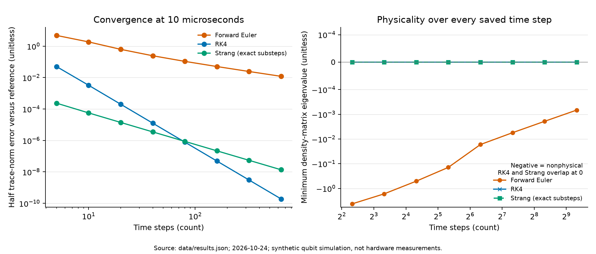

# QLPC

Quantum-computing prototypes and a standalone study of noisy-qubit numerical
methods. For the numerical-analysis example, start with the
[three-page write-up](noisy_qubit_numerics/WRITEUP.pdf) and its
[setup guide](noisy_qubit_numerics/README.md).

## Noisy-qubit numerical methods

The [standalone example](noisy_qubit_numerics/) studies two related problems:

- **Approximating noisy quantum evolution:** compare Euler, RK4 and Strang
  splitting for a one-qubit Lindblad equation, checking convergence and whether
  the computed density matrices remain physical.
- **Correcting imperfect measurements:** invert an uncertain readout model,
  propagate finite-shot calibration uncertainty, and retain failures caused by
  ill-conditioning or calibration drift.

All observations use **synthetic simulations**, not live hardware or measured
device calibrations. This is an example of established numerical methods and
readout-error mitigation, not quantum error correction, a new algorithm, or a
demonstration of quantum speedup.

### Read and explore

| Resource | Contents |
| --- | --- |
| [Write-up (PDF)](noisy_qubit_numerics/WRITEUP.pdf) · [Markdown source](noisy_qubit_numerics/WRITEUP.md) | Model, numerical comparisons, confidence construction and limitations |
| [Dynamics implementation](noisy_qubit_numerics/dynamics.py) | Lindblad and independent Bloch formulations; Euler, RK4 and exact-substep Strang integration |
| [Readout implementation](noisy_qubit_numerics/readout.py) | Two-state inversion and conservative Hoeffding confidence sets |
| [Study runner](noisy_qubit_numerics/run_study.py) | Reproducible experiment definitions, seeds and diagnostics |
| [Figures](noisy_qubit_numerics/figures/) | Dynamics, convergence/physicality and mitigation comparisons |
| [Saved results](noisy_qubit_numerics/data/) | Numerical summaries and all simulated trial counts |
| [Verification record](noisy_qubit_numerics/verification/README.md) | Tests, independent checks and extracted-package reproduction |
| [Provenance](noisy_qubit_numerics/PROVENANCE.md) | How the example extends the earlier QLPC readout demo |

### Run the example

From the repository root, using Python 3.13 as in the recorded environment:

```sh
cd noisy_qubit_numerics
python3 -m venv .venv
source .venv/bin/activate
python -m pip install -r requirements.txt
python -m unittest discover -p 'test_*.py'
python run_study.py
python plot_results.py
```

The core study needs NumPy, SciPy and Matplotlib; no quantum SDK, account or
external dataset is required. The last two commands regenerate the saved data
and figures inside the example folder.

For the optional independent Qiskit/Aer check, from that same folder:

```sh
python -m pip install -r requirements-qiskit.txt
python check_qiskit.py
```

This check validates the channel calculations and forward-noise model. It
fails explicitly if dependencies or comparisons fail; it does not silently
substitute a different method or run the original M3 mitigation routine.

### Recorded verification and findings

The [24 October 2026 verification](noisy_qubit_numerics/verification/package_check.json)
records **20 passing unit tests**, reproduction of **25,000 simulated trials**,
and **138 Qiskit channel-state comparisons** with maximum half trace-norm
discrepancy below **4.15 × 10⁻¹⁴**.

The examples retain three distinctions: a linearly stable integrator can still
produce a nonphysical state; readout inversion can amplify sampling error;
and confidence guarantees based on stable calibration do not cover calibration
drift. Observed coverage in a finite simulation is not a hardware guarantee.



*Source: the included simulated results, 24 October 2026. No hardware measurements.*

## Original QLPC application

The original Quantum-LLM Personalized Portfolio Constructor remains in
[`qlpc/`](qlpc/). It combines QAOA-based subset selection, classical convex
weight optimization, risk calculations, and an optional graph-grounded LLM
interface. Its dependencies and test suite are separate from the standalone
numerical example above.

From the repository root, in a separate environment:

```sh
python3 -m venv .venv
source .venv/bin/activate
python -m pip install -r requirements.txt
python -m qlpc demo
python -m qlpc mitigation
python -m qlpc backtest
python -m pytest tests
```

Inspect the reported method labels: the application can fall back to classical
calculations, and its tests allow those paths. Passing them does not establish
that a quantum or mitigation routine ran.

The current [`quantum_risk.py`](qlpc/quantum_risk.py) estimates a selected-tail
probability with IQAE but computes its returned CVaR separately from histogram
bin centers. Its comparator and histogram use different bin widths. That return
value should not be described as an amplitude-estimated CVaR. The original
[`mitigation.py`](qlpc/mitigation.py) is a one-qubit M3 readout-mitigation demo;
the standalone study makes the small inverse problem explicit instead.

[`RESULTS.md`](RESULTS.md), [`BENCHMARK.json`](BENCHMARK.json) and
[`VALUE.md`](VALUE.md) retain historical prototype records. They do not establish
hardware scalability or a wall-clock quantum advantage; earlier descriptions
of those capabilities should be read with the implementation limits above.
