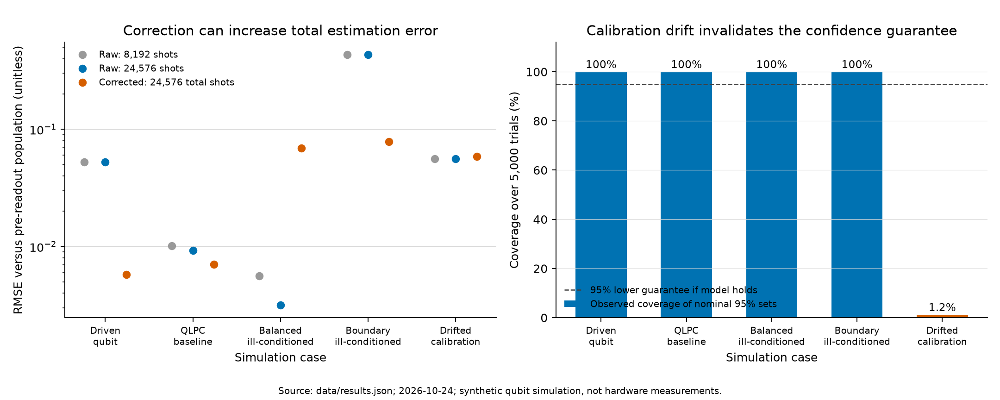

## 1. Approximate the evolution without losing the state

This example asks when a numerical approximation and a subsequent noise correction can be trusted. It extends the one-qubit readout experiment in my earlier QLPC code into two explicit problems: integrating a noisy quantum evolution, and recovering a probability from imperfect measurements. The methods are established; no novelty, hardware performance or quantum speedup is claimed. **All observations are simulated with synthetic parameters.** They describe a physically motivated model, not a calibrated device or a quantum error-correcting code.

Starting in $\rho(0)=|0\rangle\langle0|$, evolve a driven qubit for $10\,\mu\mathrm{s}$:

$$
\dot\rho=-i[H,\rho]+\sum_j\left(C_j\rho C_j^\dagger-\tfrac12\{C_j^\dagger C_j,\rho\}\right),
\qquad H=\tfrac12(\Omega X+\Delta Z).
$$

Here $\Omega=0.6$, $\Delta=0.2$ in radians per microsecond; $X,Z$ are Pauli matrices. Zero-temperature relaxation has $T_1=50\,\mu\mathrm{s}$ and transverse decay $T_2=40\,\mu\mathrm{s}$, with

$$
C_1=\sqrt{1/T_1}\,|0\rangle\langle1|,\qquad
C_\phi=\sqrt{\gamma_\phi/2}\,Z,\qquad
\gamma_\phi=1/T_2-1/(2T_1)=0.015\,\mu\mathrm{s}^{-1}.
$$

This assumes constant Hamiltonian and Markovian relaxation/dephasing. The relation $T_2\le2T_1$ is enforced. The reference is the exponential of the column-vectorized $4\times4$ Lindblad generator. An independently assembled affine Bloch formulation agrees within $2.30\times10^{-14}$ in half trace norm; it shares SciPy's exponential routine. A separate DOP853 integration agrees at the final time within $1.65\times10^{-13}$. These are floating-point cross-checks, not interval-arithmetic certificates or experimental validation of the noise model.

Compare forward Euler, classical RK4 and Strang splitting. Strang composes an exact unitary half-step, the exact dissipative step, and another unitary half-step. For this model the relaxation/dephasing subchannels commute; each substep is completely positive and trace preserving. Euler and RK4 receive no clipping, projection or renormalization. Let $E_n=\tfrac12\|\rho_n-\rho_{\rm ref}\|_1$; the observed order is $\log_2(E_{n/2}/E_n)$.

| Method | $E_{640}$ at $h=0.015625\,\mu\mathrm{s}$ | Observed order | Minimum eigenvalue over trajectory |
| :--- | ---: | ---: | ---: |
| Euler | 0.01200669 | 1.022924 | -0.000675529 |
| RK4 | $1.903305\times10^{-10}$ | 4.000467 | 0 |
| Strang | $1.362565\times10^{-8}$ | 2.000012 | 0 |

Source: `data/results.json`; all errors/eigenvalues are dimensionless. The minima include the initially pure state. RK4 stays physical on this sweep, but has no general positivity guarantee; Strang preserves positivity by construction, up to floating-point error.

The Euler stability limit for the generator's decaying modes is $h<0.11360509\,\mu\mathrm{s}$. At 640 steps its decaying-mode amplification radius is $0.99969337$, yet negative state eigenvalues remain. **Linear stability alone does not ensure a physical density matrix.** At five steps, the retained minimum eigenvalue is $-4.22534038$. The noisy final population is $0.09320338$ versus the noiseless $0.00038503$: refining a solver removes neither this physical-noise shift nor measurement noise.

Figures `dynamics.png` and `convergence.png`: population trajectories, convergence and positivity failures; source `data/results.json`, 24 October 2026, synthetic simulation.

\newpage

## 2. Readout correction is an uncertain inverse problem

Let $p$ denote the population **after physical evolution, before readout**. With $e_0=P(\text{report }1\mid0)$, $e_1=P(\text{report }0\mid1)$ and $g=1-e_0-e_1>0$,

$$
q=e_0+gp,\qquad \widehat p=\frac{\widehat q-\widehat e_0}{\widehat g},
\qquad \widehat g=1-\widehat e_0-\widehat e_1.
$$

The original QLPC example used $R_y(1.2)$, depolarization $\rho\mapsto0.98\rho+0.02I/2$, and readout errors $(e_0,e_1)=(0.07,0.12)$. Its ideal population is $0.31882112$, the depolarized population $0.32244470$, and the expected recorded frequency $0.33118021$. Perfect readout correction recovers $0.32244470$, leaving gate bias $0.00362358$. This package implements the transparent two-state inverse directly; it does **not** claim to run or benchmark M3, which the earlier demo called.

For each of five cases, run 5,000 independent complete experiments. Each uses $N=8,192$ measurement shots and $K=8,192$ calibration shots for **each** ideally prepared basis state: 24,576 shots total. Calibration is redrawn each trial. The comparison below gives the raw estimator the same total budget. All sampling uses physical reference probabilities, never an invalid Euler iterate. Point estimates outside $[0,1]$ are retained; exact zero denominators are reported as undefined, not discarded silently.

An a priori confidence construction separates sampling from inversion. For failure probability $\delta=0.05$, allocate $\delta/3$ to each of $\widehat q,\widehat e_0,\widehat e_1$. [Hoeffding's inequality](https://www.tandfonline.com/doi/abs/10.1080/01621459.1963.10500830) gives radii

$$
r_N=\sqrt{\frac{\log(6/\delta)}{2N}},\qquad
r_K=\sqrt{\frac{\log(6/\delta)}{2K}};
\qquad r_N=r_K=0.01709401.
$$

A union bound covers all three true probabilities with probability at least $0.95$. On that event, and whenever $\widehat g\ne0$, the stable forward model gives

$$
|\widehat p-p|\le\frac{r_N+(1-p)r_K+pr_K}{|\widehat g|}
=\frac{r_N+r_K}{|\widehat g|}.
$$

The implementation also forms the three clipped probability intervals, evaluates the inverse at **all eight vertices** if the entire box has positive $g$, and intersects the result with $[0,1]$. This avoids assuming calibration-coordinate monotonicity outside the feasible region. If positive $g$ cannot be certified, it returns flagged $[0,1]$; empty intersections remain flagged. These are conservative, per-experiment confidence sets under stable Bernoulli readout and ideal calibration preparations, not simultaneous trajectory bands or drift guarantees. Estimated calibration inversion is generally a biased ratio estimator.

| Case | Target $p$ | Raw RMSE, equal budget | Corrected RMSE | Covered / 5,000 |
| :--- | ---: | ---: | ---: | ---: |
| Driven qubit | 0.09320338 | 0.05238117 | 0.00578784 | 5,000 |
| QLPC baseline | 0.32244470 | 0.00922360 | 0.00702962 | 5,000 |
| Balanced, ill-conditioned | 0.50000000 | 0.00316096 | 0.06897328 | 5,000 |
| Boundary, ill-conditioned | 0.02000000 | 0.43197240 | 0.07838645 | 5,000 |
| Drifted calibration | 0.32244470 | 0.05589906 | 0.05871061 | 60 |

Source: `data/results.json`; RMSE is in probability units against the pre-readout target. The confidence sets apply to corrected estimates; the drift row violates their model. Every trial here has a finite, positive estimated gap. Raw counts for all 25,000 trials are saved in `data/readout_trials.npz`.

\newpage

## 3. Failures, scope and a question about stability

The first two cases use stable readout errors $(0.07,0.12)$. The ill-conditioned cases use $(0.45,0.45)$, so $g=0.1$. For the balanced state $p=0.5$, raw readout is already unbiased: even **known-rate** inversion multiplies its sampling variance by $1/g^2=100$ at the same measurement-shot count. Calibration uncertainty makes the observed RMSE worse still. In the boundary case, 1,971 of 5,000 corrected estimates fall outside $[0,1]$ and are kept. The positive-gap guard is tested separately; none of these trials happened to have a singular point estimate.

The drift case calibrates at $(0.07,0.12)$ but measures at $(0.13,0.10)$. The failure is model mismatch, not a contradiction of the confidence theorem. Only 60 of 5,000 nominal intervals cover the target (1.2%). Conversely, 5,000/5,000 observed coverage in a stable case does not establish 100% population coverage: the construction is conservative and the simulation is finite. A small corrected error in one trial cannot establish reliability.

Figure: equal-budget RMSE and observed coverage; source `data/results.json`, 24 October 2026, synthetic qubit simulation, not hardware measurements.

The error budget has distinct terms: numerical approximation of the chosen dynamics; physical deviation from the ideal evolution; finite-shot and calibration error in the inverse; and mismatch between calibration and operation. Readout correction addresses only the readout component. The time-stepping study addresses only discretization of the assumed model. Neither certifies an actual device, and this dense one-qubit calculation is not evidence of scalability or a quantum computational advantage.

Could stability or perturbation estimates for evolving operators give a useful criterion for choosing a time step and deciding when an uncertain correction should be trusted? Zumbrun's work on stable numerical evolution of subspaces motivates asking this, but no Evans-function connection or new method is asserted. This example supplies an inspectable initial-value problem and an inverse problem on which such a discussion can start.

**Verification.** Twenty unit tests pass, covering analytic limits, independently assembled references, convergence, positivity failures, inverse-map edge cases and confidence coverage. Optional Qiskit/Aer checks agree with Strang across 138 channel-state comparisons to $4.15\times10^{-14}$ in half trace norm, and independently reproduce the QLPC forward-noise model. An Aer run of 200,000 shots gives $0.33134$ versus expected $0.33118021$. The optional check fails explicitly if dependencies or comparisons fail. Saved results were independently recomputed from all recorded seeds; no failing shots or nonphysical iterates were removed.

**Sources.** Starting point: `qlpc/mitigation.py`, commit `63c325b` (provenance and exact parameters in `PROVENANCE.md`). Established background: [Nation et al., measurement-error mitigation (2021)](https://arxiv.org/abs/2108.12518); [Qiskit Aer relaxation channels](https://qiskit.github.io/qiskit-aer/stubs/qiskit_aer.noise.thermal_relaxation_error.html); [SciPy's matrix exponential and its algorithm references](https://docs.scipy.org/doc/scipy/reference/generated/scipy.linalg.expm.html); [Zumbrun, numerical error analysis for Evans-function computations (2009)](https://arxiv.org/abs/0904.0268). This package uses established methods as a numerical experiment.
