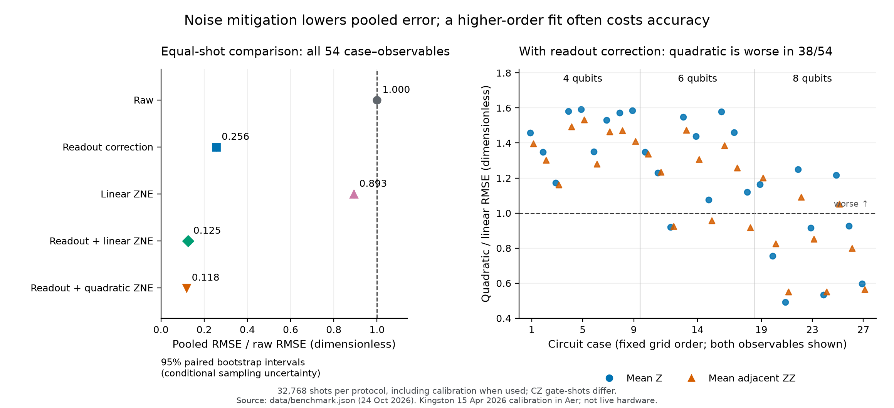

## 1. A calibrated circuit experiment with explicit targets

I compare readout correction and zero-noise extrapolation on entangling 4-, 6- and 8-qubit circuits, accounting for calibration shots. The numerical question is whether correcting physical noise improves an estimate once approximation error and statistical amplification are included. **These are Qiskit Aer simulations of IBM Kingston's 15 April 2026 calibration snapshot, not live hardware experiments.** The methods are established; this study makes no novelty, scalability or quantum-advantage claim.

The problem is an open transverse-field Ising chain, initially $|0\cdots0\rangle$, with $\hbar=1$:

$$
H=H_{ZZ}+H_X=\sum_{j=0}^{n-2}Z_jZ_{j+1}+0.7\sum_{j=0}^{n-1}X_j,
\qquad
S_2(\Delta)=e^{-i\Delta H_X/2}e^{-i\Delta H_{ZZ}}e^{-i\Delta H_X/2}.
$$

I use $n\in\{4,6,8\}$, model times $T\in\{0.5,1,1.5\}$ in units $1/J$, and $s\in\{2,4,8\}$ product-formula steps, $\Delta=T/s$. These are 27 fixed cases, each with two observables: mean $Z$ magnetization and mean adjacent $ZZ$ correlation, both bounded by $[-1,1]$. Model time is distinct from hardware gate duration. The **primary mitigation target** is the ideal digital circuit $S_2(T/s)^s$; exact Hamiltonian evolution $e^{-iTH}$ is a separate reference for product-formula error. No fit or case is selected for its favorable result.

I map the circuits to physical qubits $0,1,\ldots,7$, using prefixes for smaller registers. This is the lexicographically first connected calibrated path passing the stated operational checks, selected before examining mitigation outcomes. The frozen model includes native-gate depolarization and thermal relaxation, gate durations, $T_1/T_2$, and independent directional readout errors. Source calibration files and the remapped model are hashed. Qubit 1 has substantial assignment errors: $P(1|0)=0.23022461$ and $P(0|1)=0.10620117$. Every case includes this site, so gains over raw data are partly readout-dominated and are not independent confirmations across devices.

For readout correction, I estimate each local assignment matrix from all-zero and all-one calibration circuits, with noisy $X$ preparation included. The factorized inverse estimates $Z_j$ as $(z_j-(\widehat e_{1j}-\widehat e_{0j}))/\widehat g_j$, where $\widehat g_j=1-\widehat e_{0j}-\widehat e_{1j}$; adjacent products give $ZZ$. This matches the model's independent readout assumption, but calibration preparation error can bias the inverse. It is not an implementation of M3's matrix-free algorithm.

For extrapolation, each compiled native CZ is replaced by 1, 3 or 5 copies, separated by barriers. CZ squares to the identity, so the ideal computation is unchanged. Non-CZ operations and qubit mapping are fixed. **Only CZ noise is amplified**: the extrapolated intercept need not remove one-qubit or preparation noise. For fold means $y_1,y_3,y_5$, the fixed linear least-squares and quadratic intercepts are

$$
\widehat y_{L}=\tfrac{13}{12}y_1+\tfrac13y_3-\tfrac5{12}y_5,
\qquad
\widehat y_{Q}=\tfrac{15}{8}y_1-\tfrac54y_3+\tfrac38y_5.
$$

Each protocol receives **32,768 total shots**, including calibration when used. Both observables share the same measured bitstrings. Equal shots do not imply equal circuit-execution cost:

| Protocol | Calibration shots | Measurement shots at folds (1,3,5) | CZ gate-shot cost / raw |
| :--- | ---: | :--- | ---: |
| Raw | 0 | (32768, 0, 0) | 1.000 |
| Readout correction | 4096 | (28672, 0, 0) | 0.875 |
| Linear ZNE | 0 | (10923, 10923, 10922) | 3.000 |
| Readout + linear ZNE | 4096 | (9558, 9557, 9557) | 2.625 |
| Readout + quadratic ZNE | 4096 | (9558, 9557, 9557) | 2.625 |

Calibration uses 2,048 shots per preparation circuit, not per qubit. The unfolded circuits have 12-112 CZ gates; the largest folded circuit has 560. Gate counts, budgets and model details are saved in `multiqubit/data/`.

\newpage

## 2. Error reduction and the failures it can conceal

For each fixed circuit I generate 500 independent synthetic shot/calibration replicates from its saved density-matrix distributions. Nested shot prefixes couple methods for paired comparisons; each corrected method is still charged its full calibration cost, and a replicate's calibration is shared across its folds. These are statistical resamples of a fixed simulator model, not repeated hardware jobs. Pooled RMSE gives equal weight to all 27 cases and both observables. The 1,000-replicate bootstrap resamples rows within each fixed case while preserving method/observable dependence; its intervals describe conditional sampling uncertainty, not uncertainty in the noise model or simultaneous per-case coverage.

| Protocol | Pooled RMSE vs digital target | RMSE / raw (95% bootstrap) | Pooled RMSE vs exact Hamiltonian |
| :--- | ---: | :--- | ---: |
| Raw | 0.143902 | 1.0000 | 0.120915 |
| Readout correction | 0.036833 | 0.2560 [0.2553, 0.2567] | 0.067626 |
| Linear ZNE | 0.128509 | 0.8930 [0.8925, 0.8936] | 0.107146 |
| Readout + linear ZNE | 0.017972 | 0.1249 [0.1240, 0.1258] | 0.068715 |
| Readout + quadratic ZNE | 0.016948 | 0.1178 [0.1165, 0.1190] | 0.069716 |

Source: `multiqubit/data/benchmark.json`; all errors are dimensionless observable errors. All four mitigated protocols beat raw on the primary target in all 54 case-observable comparisons, for this path and snapshot. The quadratic combined method has the lowest pooled RMSE, but **is worse than the linear combined method in 38 of 54 comparisons**, and worse than readout-only in 12. Its negative extrapolation weights amplify sampling error. No undefined inversions or estimates outside $[-1,1]$ occurred here; the implementation reports them if they occur rather than clipping or silently omitting them.

A concrete retained failure is 4 qubits, $T=1$, 4 steps, mean $Z$: combined linear RMSE is $0.00924705$, while quadratic is $0.01472156$. Their ratio is $1.5920$ with paired bootstrap interval $[1.4898,1.7102]$. This case illustrates why a higher-order fit is not automatically better. The quadratic fit has three parameters and three points: it has no residual degrees of freedom, so residual-based fit confidence intervals would be inappropriate.

Figure: all 54 comparisons retained; source `multiqubit/data/benchmark.json`, 24 October 2026. Kingston 15 April 2026 calibration in Aer; no live hardware.

[The depth figure](https://github.com/pbathuri/qlpc/blob/main/noisy_qubit_numerics/multiqubit/figures/depth_tradeoff.png) shows Hamiltonian-target RMSE and absolute product-formula bias versus steps at $T=1/J$. The CSV retains all 270 rows (bias, both RMSE targets, costs, failures); the NPZ retains all replicate estimates and calibration marginal counts.

\newpage

## 3. Approximation bias, residual noise and what is verified

For an observable, let $y$ be the exact Hamiltonian value and $y_s$ the ideal product-formula value. The error budget is

$$
\widehat y-y=(\widehat y-y_s)+(y_s-y).
$$

Noise mitigation targets the first term. The second is an approximation error, not a readout or gate-noise error. Its largest magnitude in this grid is $0.20431447$ (8 qubits, $T=1.5$, 2 steps, mean $Z$), much larger than the best pooled mitigation error. The table's Hamiltonian column therefore changes the apparent ranking: readout-only has lower pooled error against that target than either combined ZNE method. In 14 of 54 comparisons, each readout-based protocol is worse than raw against the Hamiltonian target because raw noise partly cancels product-formula bias. This is not evidence that the noisy circuit is generally a better dynamics solver. Both targets remain visible.

I also calculate a diagnostic with CZ errors disabled but one-qubit/readout errors retained. It is **excluded from both fits**. For 8 qubits, $T=1$, 8 steps, mean $Z$, the ideal digital value is $0.63381245$. The CZ-noise-off value after population-level readout correction is $0.62385224$; combined linear and quadratic population intercepts are $0.60541245$ and $0.62126419$. Thus even an accurate extrapolation toward this selective endpoint retains unscaled noise. These population quantities use exact model distributions and effective calibration rates; they are not finite-shot estimates.

[Selective extrapolation figure](https://github.com/pbathuri/qlpc/blob/main/noisy_qubit_numerics/multiqubit/figures/selective_extrapolation.png): population means for the fixed case, without sampling error bars.

Source: `multiqubit/data/benchmark.json`, 24 October 2026; dated Kingston calibration in Aer, not live hardware.

**Verification.** Eighteen multi-qubit tests pass. The remapped 38 quantum channels agree with the source channel matrices within $3.0\times10^{-15}$, and eight readout channels match the directional calibration. All 81 folded ideal states preserve the computation and exact CZ scaling; the largest compiler probability discrepancy is $6.55\times10^{-15}$. Independent Kronecker-Hamiltonian reconstruction agrees with the saved continuous reference within $3.50\times10^{-15}$. A 131,072-shot Aer check validates measurement/readout ordering. Independent recomputation reproduces all 27 cases, replicate estimates and bootstrap summaries. The frozen model, seeds, configuration, tests and verification records are included.

Two implementation details matter numerically. BackendV2's default averaged readout errors are replaced by the snapshot's directional assignment probabilities. Also, equivalent consolidated channel representations avoid Aer truncation of very small probabilistic Kraus branches; channel equality is checked independently. Density-matrix normalization is checked before correcting only floating-point-scale residuals. These checks establish consistency of the implemented model, not fidelity to an actual device.

The model omits a timed idle schedule, crosstalk, correlated readout, leakage, calibration drift and coherent-error characterization beyond the supplied channel construction. Only one snapshot and one path are studied. This is an inspectable small-system benchmark, not a hardware result, a reproduction of IBM's large-scale experiments, or a new mitigation algorithm. Can we choose product-formula resolution and extrapolation order using a reliable error estimate, rather than knowing the exact answer? That is the question I would like to explore; no Evans-function method is claimed to apply here.

**References:** [Nation et al., measurement mitigation (2021)](https://arxiv.org/abs/2108.12518); [Majumdar et al., digital ZNE best practices (2023)](https://arxiv.org/abs/2307.05203); [IBM's Ising-model mitigation experiment (2023)](https://www.nature.com/articles/s41586-023-06096-3); [Aer device-noise construction](https://qiskit.github.io/qiskit-aer/stubs/qiskit_aer.noise.NoiseModel.html); [Zumbrun, numerical error analysis (2009)](https://arxiv.org/abs/0904.0268). See `multiqubit/PROTOCOL.md` for the fixed comparison rules.
